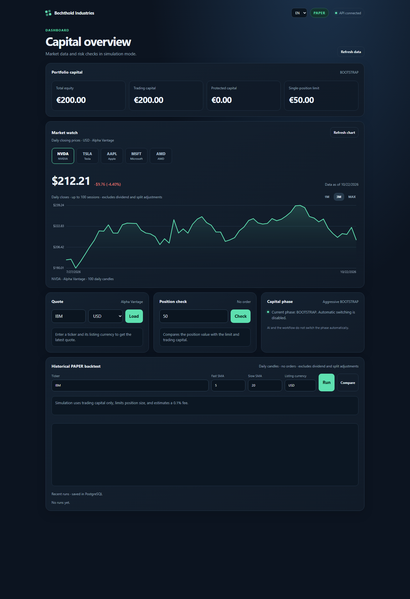
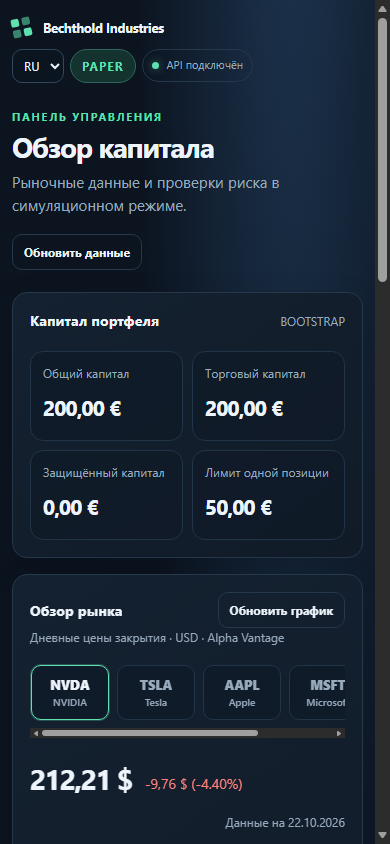
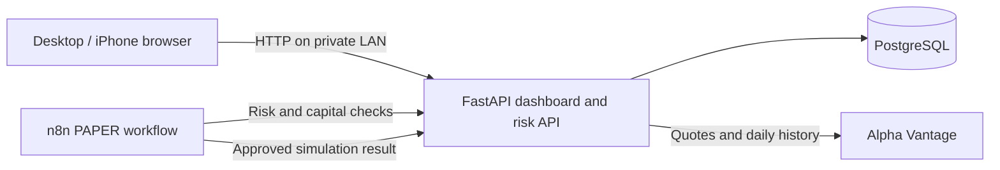

# Bechthold Industries — project case study

## Overview

Bechthold Industries is a private, local-first market research dashboard for desktop and iPhone. It brings a curated stock watchlist, historical price charts, portfolio capital controls and repeatable strategy analysis into one self-hosted application.

The system is deliberately **PAPER-only**. It does not connect to a broker, place orders or claim that a backtest predicts future results. The project is intended for one person to run on a home computer, with an iPhone connecting over the same private Wi-Fi network.

## Interface preview

Desktop and mobile screens captured from the running local application:

Download the [formatted three-page case study](../output/pdf/bechthold-industries-case-study.pdf).





## Product problem

Small strategy experiments are easy to misread when market data, capital assumptions and risk limits live in separate tools. The platform keeps those assumptions visible, makes capital protection explicit and labels historical strategy results as simulations.

## What it does

- Displays a ten-stock watchlist (NVDA, TSLA, AAPL, MSFT, AMD, GOOG, AMZN, META, ORCL and JPM) with selectable daily price charts.
- Fetches quotes and daily history from Alpha Vantage, with a PostgreSQL cache to reduce repeated requests.
- Tracks total equity, protected capital, trading capital and the position limit as separate values.
- Requires a token-protected manual action before moving from BOOTSTRAP to PROFIT_ONLY.
- Rejects position sizes above the current position or trading-capital limits.
- Runs an SMA crossover backtest and a small parameter comparison with a holdout period.
- Saves PAPER analysis history in PostgreSQL and supports validated backup and restore to a new database.
- Serves an installable responsive web app that can be added to an iPhone home screen on the local network.

## Architecture



The browser presents the dashboard and calls the API. FastAPI owns capital-state calculations, validates requested position sizes and runs the analytical backtests. PostgreSQL stores capital state, cached market data and analysis history. n8n coordinates a PAPER workflow and cannot switch the capital phase automatically.

## Capital and safety model

The default state starts with €200 of total equity, €200 of trading capital, no protected capital and a €50 maximum position. When equity reaches €350, €200 becomes protected and the phase transition remains pending until a manual token-protected confirmation. After confirmation, only the amount above protected capital is available for trading. If equity falls, protected capital is capped at available equity and trading capital cannot become negative.

Capital-changing API actions fail closed if the confirmation token is absent or invalid. The n8n workflow uses PAPER results only. No live-trading or broker-order path is included.

## Technology

| Area | Technology |
| --- | --- |
| API and analytics | Python, FastAPI |
| Persistence | PostgreSQL, psycopg |
| Local services | Docker Compose |
| Workflow automation | n8n |
| Market data | Alpha Vantage |
| Interface | Responsive HTML, CSS and JavaScript; installable PWA |
| Tests and CI | Python `unittest`, Node.js built-in test runner, GitHub Actions |

## Run locally

Use Windows with Docker Desktop. Copy `.env.example` to `.env`, add an Alpha Vantage API key, then run:

```powershell
./scripts/start-platform.ps1
```

The script reports the dashboard URL for the computer and the private-network URL to open in iPhone Safari. The iPhone and computer must be on the same Wi-Fi. The app is not hosted publicly; the computer still needs outbound internet access to retrieve market data.

## Verification

The current API regression suite contains 43 passing tests. The n8n workflow suite contains 7 passing tests. A GitHub Actions workflow runs both suites on pushes to `main`, pull requests and manual dispatch. Manual local checks confirm the API is ready, the default capital state is PAPER/BOOTSTRAP at €200, a €50 position passes, a €60 position fails, and the PWA manifest and icon are served successfully.

## Known boundaries

- Alpha Vantage plan limits and outages can restrict quote and history availability.
- The curated watchlist is not a ranking by live traded volume.
- Daily history is raw and unadjusted for splits or dividends, which can distort historical comparisons.
- Backtests use simplifying assumptions and do not include slippage, taxes or all market microstructure effects.
- This local personal tool is not hardened or reviewed as a public multi-user service.
- The iPhone experience is a PWA shortcut, not a native App Store application.

## Future improvements

1. Improve market data provenance and adjusted-price support when provider access permits.
2. Add authentication and a deployment security review before considering access beyond one trusted local user.
3. Keep any future broker execution integration out of scope until separately designed, reviewed and explicitly authorized.
